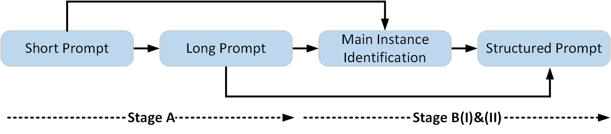

# InstanceEnhancer



## Setup and usage

Install the OpenAI Python SDK:

```bash
python -m pip install openai
```

In `enhance_prompt_gpt4o.py`, set `api_key` and `txt_path` to your API key
and input text file, respectively. The input file should contain one prompt
per line.

Run from the repository root:

```bash
python InstanceEnhancer/enhance_prompt_gpt4o.py
```

Or run from the `InstanceEnhancer` directory:

```bash
python enhance_prompt_gpt4o.py
```

The output is written to `enhance prompt.jsonl` in the current working
directory. To change the requested number of instances, edit `no more than 3`
in the subject-extraction prompt.

## Few-shot examples

The two message lists used by the enhancer are defined in
[`InstanceCap/projects/human_hit.py`](../InstanceCap/projects/human_hit.py):

- `example_message`: examples for expanding a short prompt into a detailed story.
- `split_example_message`: examples for extracting instances separated by `BREAK`.

The script resolves this shared module relative to its own file location,
so no manual `PYTHONPATH` configuration or copying of `human_hit.py` is needed.
